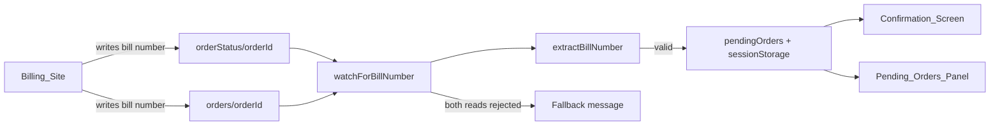

# Design Document

## Overview

The Ordering_Site (`public/index.html`) currently listens only on `orderStatus/{orderId}` for a field named `billNo` and coerces it with `Number()`. The bill number is not shown when the Billing_Site:

- writes the number to `orders/{orderId}` instead of `orderStatus/{orderId}`,
- uses a different field name (e.g. `billNumber`, `bill_no`),
- writes a string such as `"A12"` (becomes `NaN`),
- or the read is rejected by database security rules (error is silently swallowed).

`watchForBillNumber` is also defined twice in the file. The fix replaces both copies with one listener that watches both paths, accepts known field-name variants, keeps string values, and reports read errors.

## Architecture



## Components and Interfaces

All changes live in the main script of `public/index.html`.

- `extractBillNumber(value)`: Accepts a snapshot value. Returns the first Valid_Bill_Number found under the keys `billNo`, `billNumber`, `bill_no`, `bill_number`, `bill`. A value is valid if it is a finite number or a non-empty trimmed string. Returns `null` otherwise. (Req 2.3)
- `formatBillNumber(billNo)`: Numbers and all-digit strings are padded with leading zeros to 3 digits. Other strings are returned unchanged. (Req 2.1, 2.2)
- `watchForBillNumber(orderId, isCurrentConfirmation)`: The single remaining definition. It attaches `value` listeners on both `orderStatus/{orderId}` and `orders/{orderId}`, each with an error callback. The first valid bill number updates the order, persists it, refreshes the UI and detaches both listeners. (Req 1.1–1.3, 3.2)
- Error callback: Logs `console.error('[bill-number]', orderId, path, err.code)`. When both paths have failed, it sets `order.billError = true` and refreshes the UI. (Req 4.1, 4.2)
- `renderPendingOrdersPanel` / `updateSingleConfirmationScreen`: Use `formatBillNumber`. They show "Ask the counter for your bill number" when `billError` is set and the waiting message otherwise. (Req 1.4, 4.2)
- `loadPendingOrders`: Keeps `billNo` as stored (string or number) and stops coercing it with `Number()`. `attachPendingOrderListeners` already resumes listeners on load. (Req 3.1)

## Data Models

Pending order (sessionStorage `PENDING_ORDERS_STORAGE_KEY`):

```js
{ id: string, table: string, placedAt: number, billNo: string | number | null, billError?: boolean }
```

Realtime_Database (read only, written by Billing_Site): `orderStatus/{orderId}` and/or `orders/{orderId}`, containing one of the supported bill-number keys.

## Error Handling

- Listener read rejected: log the order ID, path and error code. Show the fallback message only when both paths are rejected.
- Invalid or empty value: ignored. The listener stays attached and the waiting message stays visible.
- Exceptions inside a listener: caught and logged, as today.
- Rendering uses `textContent` or escaping, so a string bill number cannot inject HTML.

## Testing Strategy

The project has no test framework. `extractBillNumber` and `formatBillNumber` are pure functions, so a small Node script using `node:assert` can test them. That script needs the functions copied out or exposed. Covered cases: numeric, numeric string, alphanumeric string, empty, null and alternate keys. Listener behaviour is verified manually by writing a value under each path in the Firebase console.
